# RyvFnoAI — Agentic AI inside Dynamics 365 Finance & Operations

> Documentation for **RyvFnoAI**, an independent R&D project by Yevgenii Romanov: an AI agent that runs **inside** Dynamics 365 Finance & Operations, reads ERP data, explains it, builds reports and — with your confirmation — creates and updates records.
>
> This repository contains documentation and screenshots only. The software itself is not distributed here.


%20%7C%20OpenAI%20(tested)%20%7C%20Azure%20OpenAI%20(preview)-6E40C9)


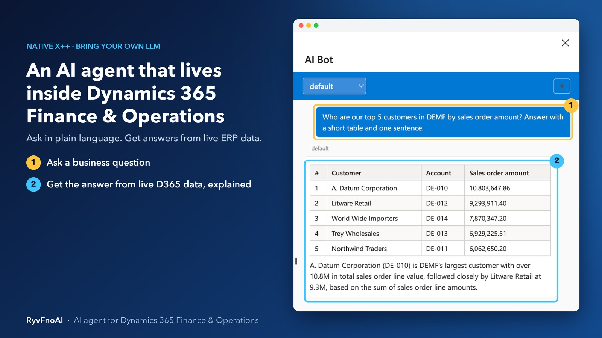

📰 **Article:** [I Built an AI Agent That Lives Inside Dynamics 365 Finance & Operations](https://www.linkedin.com/pulse/i-built-ai-agent-lives-inside-dynamics-365-finance-heres-romanov-4ohlf/)

### ▶️ 40-second teaser

https://github.com/user-attachments/assets/08118f24-a8e1-4fe5-817c-460053c8ad5b

<sub>Can't see the player? [Download the video](media/teaser/RyvFnoAI_teaser_16x9_music.mp4). Music: "Technology Corporate" by The_Mountain (Pixabay).</sub>

> **Status: Beta (1.1).** The agent loop runs entirely on the F&O server: steps are shown live while it works, long tasks can move to a background batch job so the browser can be closed, and every change is confirmed in X++. The **Anthropic Claude** (including Anthropic-compatible APIs) and **OpenAI** providers are tested end to end; the **Azure OpenAI** provider is implemented and in validation. We are onboarding the first pilot customers — see [Licensing](#licensing).

---

## What it is

RyvFnoAI is a model for **Microsoft Dynamics 365 Finance & Operations**, built as a standard ISV-style extension, that embeds a tool-using AI agent directly into the D365FO web client. Users talk to their ERP in plain language; the agent decides which tools to call, runs them inside the AOS under the user's own security context, and answers with real data.

It is not a chatbot bolted onto an export. It runs natively in X++, next to your data.

```
"Show me all open sales orders for customer US-001 over 10,000 USD"
"Why is vendor invoice VI-00451 stuck? Check the workflow and the matching status"
"Export overdue customer invoices for USMF to Excel, grouped by collector"
"Create a new customer Contoso Ltd with payment terms Net30"   ← you confirm in the panel
"Export all tax transactions for USRT to Excel"                 ← runs as a batch job, file appears in the chat
```

## Key characteristics

| | RyvFnoAI |
|---|---|
| **Runs inside D365FO** | Native X++ model, no middleware server to host; the whole agent loop runs on the AOS, works in cloud and on-premises environments from 10.0.45 |
| **Live steps and background runs** | Every step (which tool, which table, what it found) appears in the panel while the agent works; long tasks move to a standard F&O batch job after your confirmation, so you can close the browser and come back to the result |
| **No extra subscriptions** | No Copilot Studio, Copilot Credits, Microsoft 365 Copilot, Power Platform integration or Dataverse required, just an API key from the model provider you choose |
| **A side panel, not another screen** | Opens from the settings (gear) menu on any page, next to the form you are working in; the agent can read the open form and the selected record |
| **Bring your own model** | Anthropic Claude and OpenAI (tested), Azure OpenAI (in validation) — switch providers in one parameter |
| **Acts, not only answers** | 36 built-in tools: query, look up, count, explore table relations, create / update / delete records (one by one or in bulk), work through a form's own business logic, run multi-step X++ operations, open forms, switch company, export files, generate reports, run batch processing |
| **Nothing is written without your click** | The agent prepares a change and shows the exact preview in the panel; only your **Confirm** saves it, enforced in X++. If the record changed after the preview, nothing is saved and you get a fresh preview. Bulk changes ("block all customers in group 30") need one confirmation |
| **Large exports, the standard way** | Exports of hundreds of thousands of rows run as a standard F&O batch job (CSV, zipped CSV, or Excel split across sheets); the file is attached to the chat session and downloaded from the panel. Tested with 270,000+ rows |
| **Files in the chat** | Attach an image, PDF, CSV or text file to your question (for example, a scanned invoice to check against F&O); reports and exports appear in a *Files* list in the panel |
| **Granular control** | Per-user allow-lists for **tools** and **agents** on top of standard D365FO role security; table-level restrictions enforced at runtime for every data tool, including raw SQL reads (tables in joins, comma lists, subqueries and CTEs are all checked) |
| **Extensible by partners and customers** | Build your own tools without changing RyvFnoAI code: in X++ in your own model, registered through a published extension point, or as an MCP server in any language (Jira, Confluence, GitHub, internal APIs work the same way). Custom and remote tools appear next to the built-in ones and follow the same per-user permissions |
| **Knows your company** | Built-in knowledge base with semantic search (RAG): upload policies, procedures, manuals; the agent cites them in answers |
| **Multi-agent** | Define specialised agents (AP clerk, inventory analyst, month-end closer) with their own instructions and tool sets; agents can delegate to each other |
| **Remembers each user** | Per-user memory built into the panel: the agent learns how each person works ("our fiscal year ends in March", "always show amounts in EUR") and uses it in every new session; users can review and delete what it remembers |
| **Learns your environment in one click** | *Initialize knowledge* scans your environment's metadata, including your own customisations and extensions, and turns it into instructions for the agent, so it understands your system from day one. Only metadata (names of tables, fields, classes) is sent to the model, not business data |
| **Engineering quality** | Encrypted API keys, sensitive fields excluded from data entities, private chat sessions, retention batch job, 0 compile errors / 0 BP errors |

## What it covers

| D365FO area | Status |
|---|---|
| Read data, aggregations, metadata, table relations | ✅ Built-in tools |
| Create / update / delete records with validation, single or bulk | ✅ Confirmed in the panel, enforced in code; enabled per user |
| Work through a form's own business logic | ✅ Built-in tools |
| Open forms, read the open form and selected record | ✅ Built-in tools |
| Files: exports (incl. large batch exports), reports, downloads | ✅ Built-in tools |
| Files you attach to the chat (image, PDF, CSV, text) | ✅ Built-in |
| Company knowledge (policies, procedures, manuals) | ✅ Knowledge base with semantic search |
| Posting, workflow submission, number sequences | 🧪 Multi-step operations, guided by the knowledge base |
| Attachments on F&O records (DocuRef upload / read), SSRS report output | 🗺 Roadmap |
| Your own tools | ✅ X++ extension point or MCP servers |

✅ available · 🧪 working, being validated · 🗺 planned

## See it in action

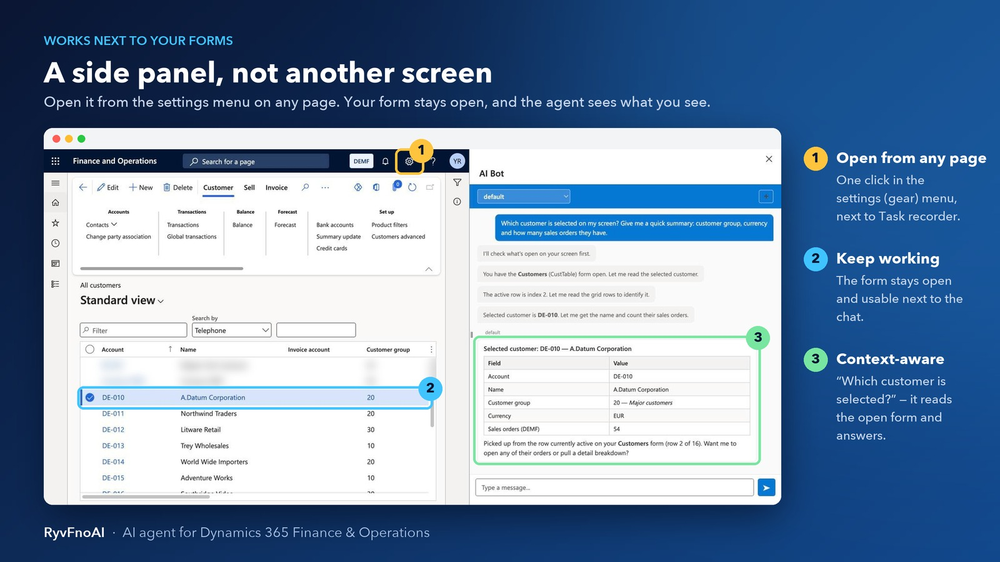

<table>
<tr>
<td width="50%">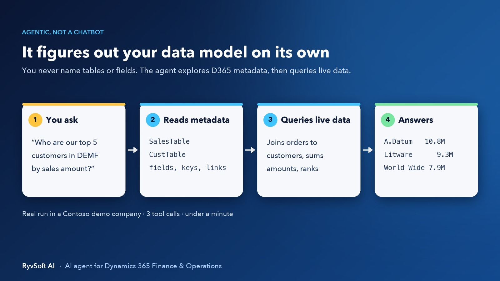</td>
<td width="50%">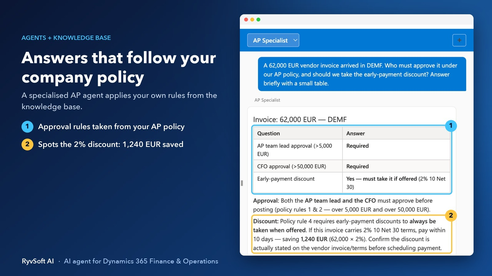</td>
</tr>
<tr>
<td>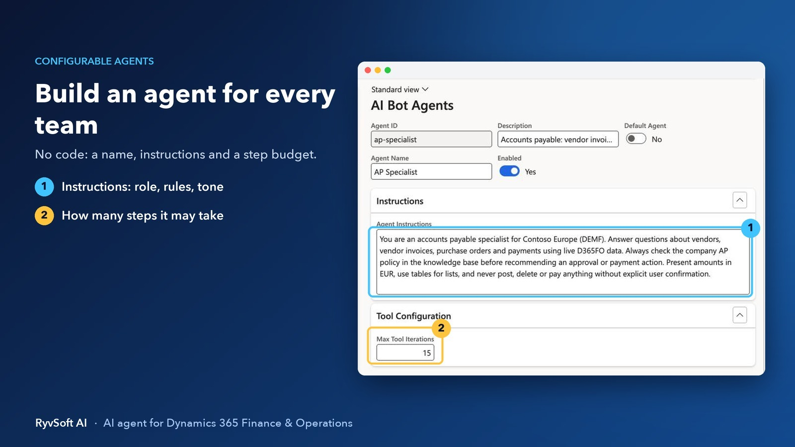</td>
<td>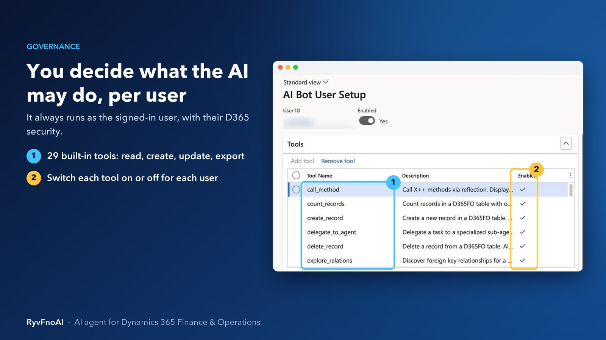</td>
</tr>
<tr>
<td>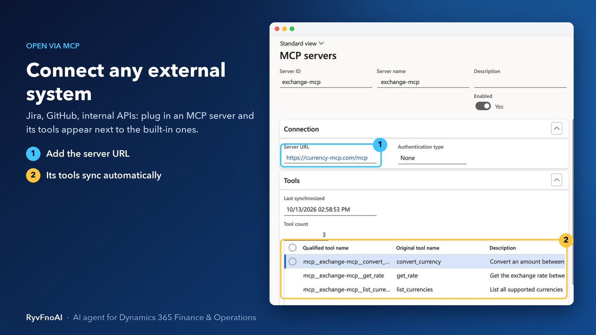</td>
<td></td>
</tr>
</table>

<details>
<summary><b>More screenshots</b> (setup forms, knowledge base, RAG settings, sessions)</summary>

<table>
<tr>
<td width="50%">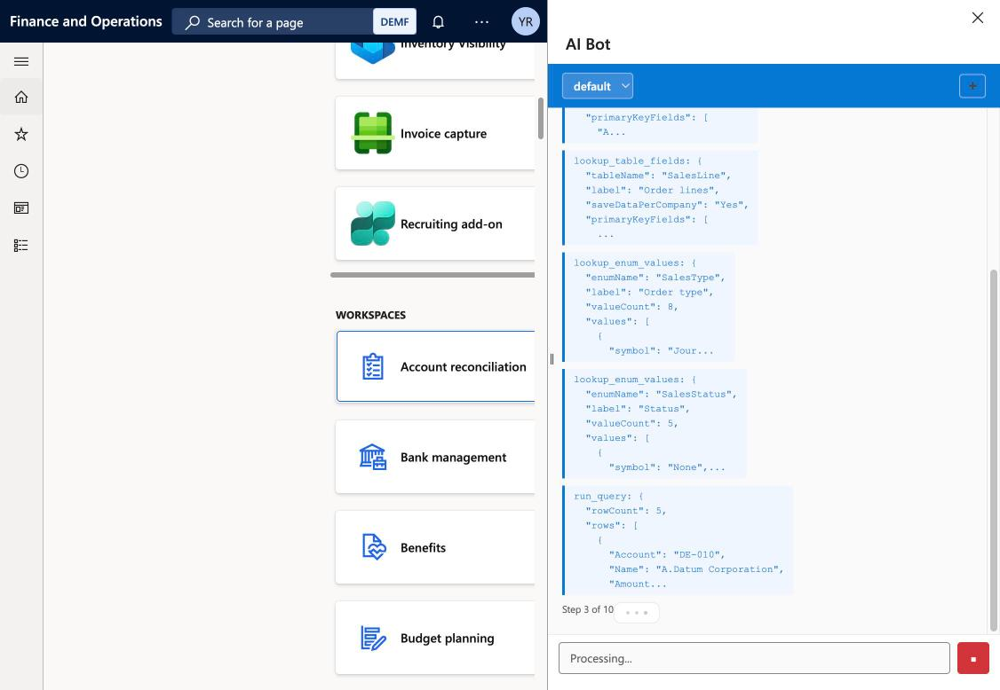<br><sub><b>Agentic tool use</b> — the agent inspects tables and enums, builds a query and runs it</sub></td>
<td width="50%">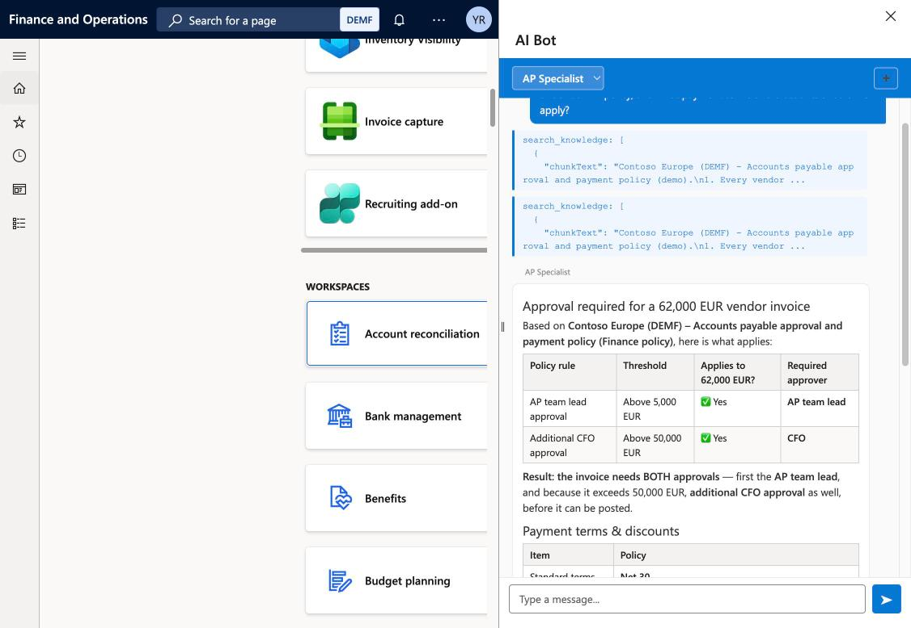<br><sub><b>Specialised agent + knowledge base</b> — "AP Specialist" answers from the company AP policy (RAG)</sub></td>
</tr>
<tr>
<td>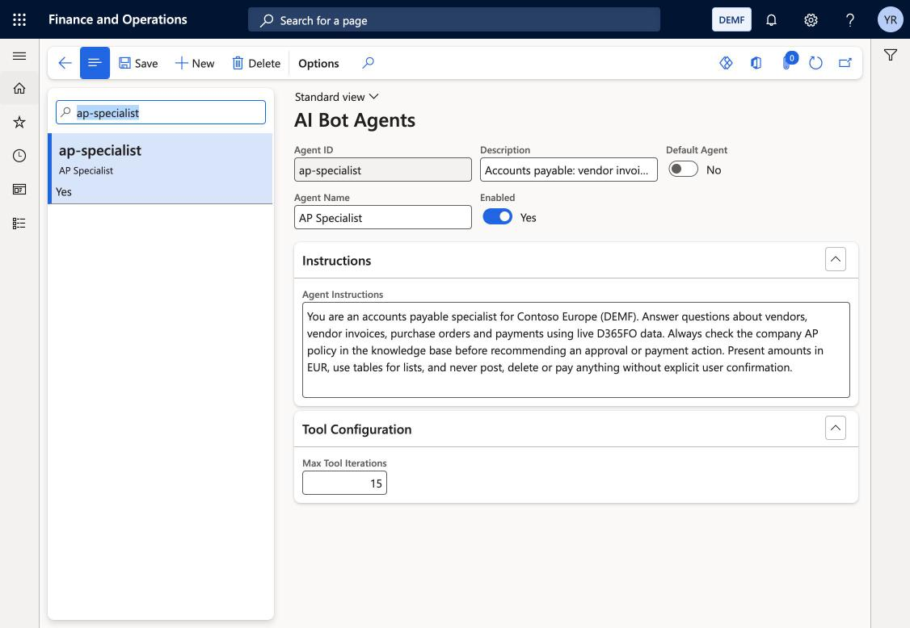<br><sub><b>Agents</b> — custom instructions and iteration budget per agent</sub></td>
<td>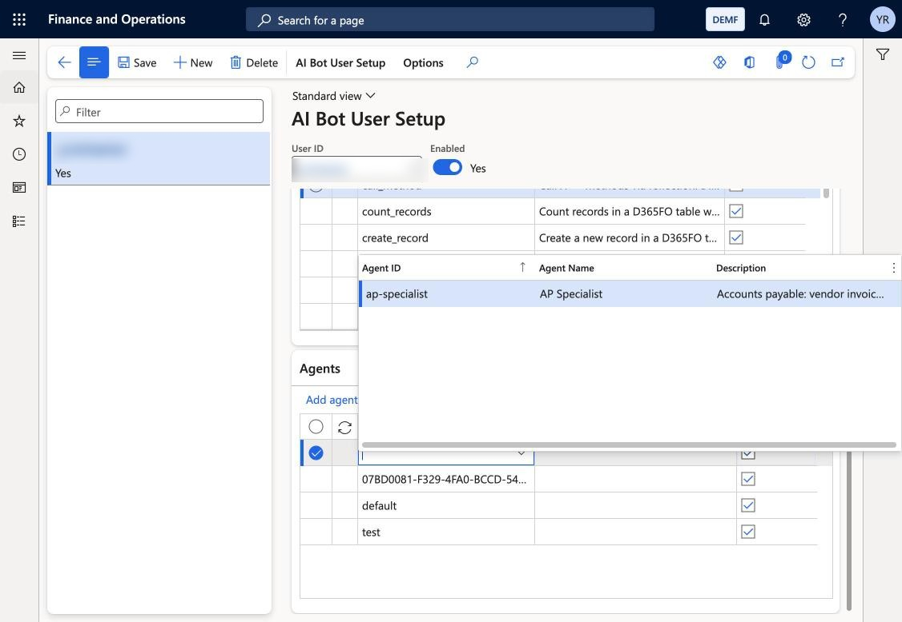<br><sub><b>User setup</b> — grant agents and tools per user</sub></td>
</tr>
<tr>
<td>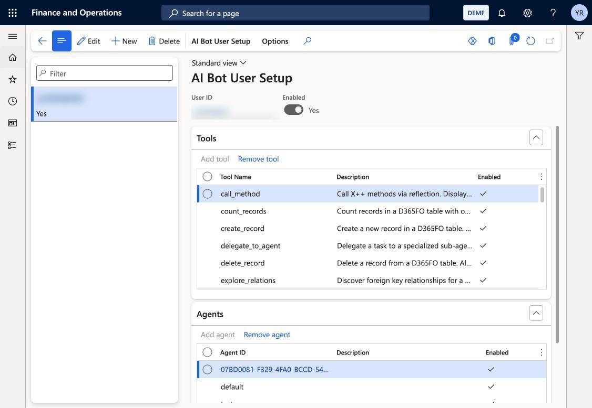<br><sub><b>Tool access</b> — each built-in tool can be switched on/off per user</sub></td>
<td>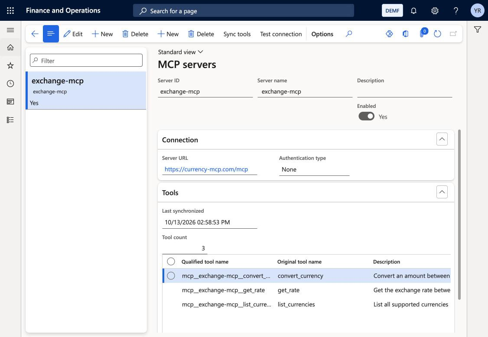<br><sub><b>MCP servers</b> — connect, test, sync remote tools</sub></td>
</tr>
<tr>
<td>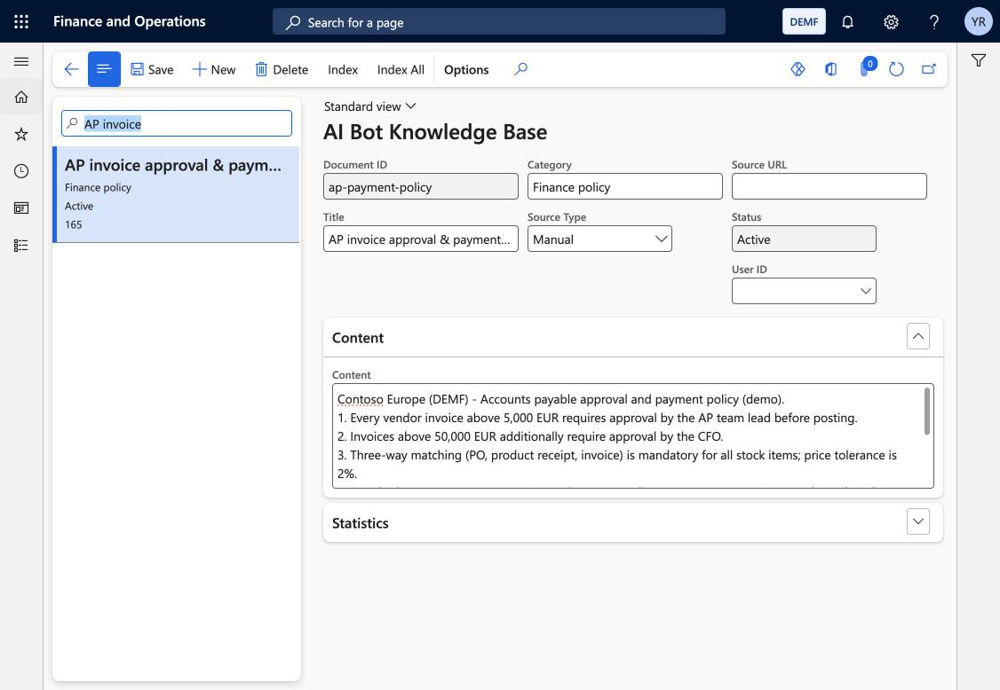<br><sub><b>Knowledge base</b> — manual text, files or URLs, indexed into chunks</sub></td>
<td>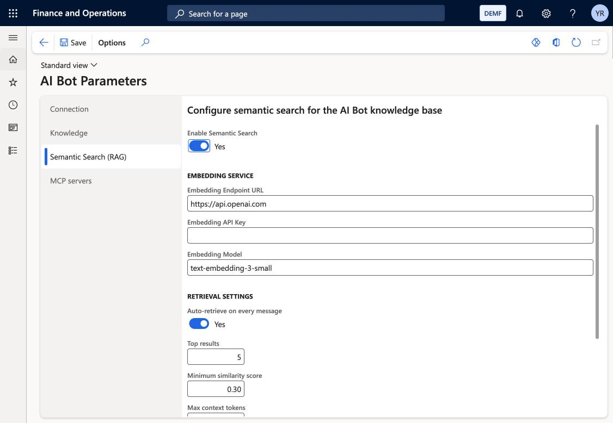<br><sub><b>Semantic search (RAG)</b> — embeddings, top-K, similarity threshold</sub></td>
</tr>
<tr>
<td>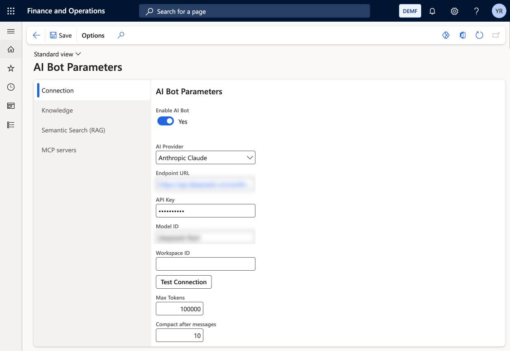<br><sub><b>Provider</b> — Azure OpenAI, OpenAI or Anthropic; key stored encrypted</sub></td>
<td>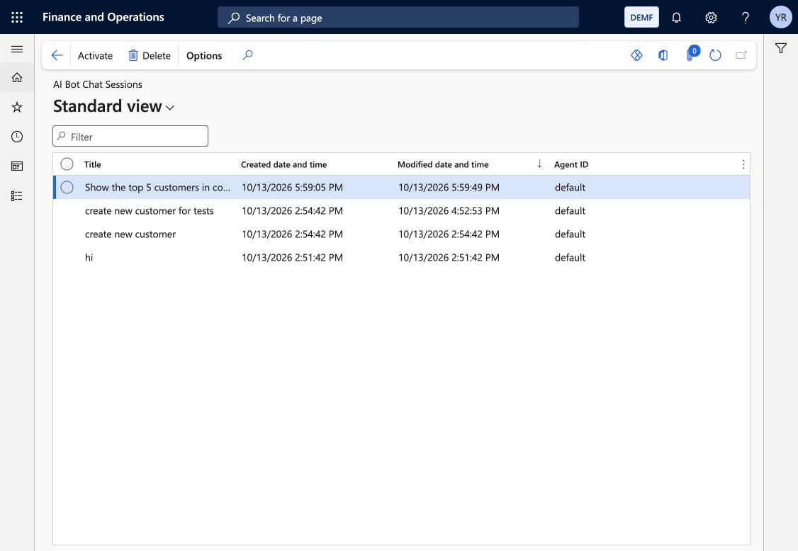<br><sub><b>Chat sessions</b> — private per user, resumable, retention clean-up job</sub></td>
</tr>
</table>

</details>

## Capabilities at a glance

**Data** — natural-language queries across any table the user is allowed to see, record lookup, counts and aggregates, relation exploration, field-level reads.

**Changes** — create, update and delete records, one by one or in bulk, through a preview and a Confirm button in the panel that is enforced in X++; stale previews are rejected.

**Navigation & context** — read the form you have open and the selected record, find menu items and open forms, search labels and metadata, inspect table fields and enum values, read the current form context, switch legal entity.

**Output** — CSV / Excel / file export, generated reports, task-recorder assistance.

**Reasoning** — planning (to-do / think tools), long-running multi-step workflows (configurable iteration budget per agent), automatic context compaction for long conversations.

**Knowledge** — documents from manual text, files or URLs; chunking, embeddings, cosine-similarity retrieval; auto-retrieve per message or on demand.

**Integration** — your own X++ tools registered through an extension point; MCP client with Bearer / API-key auth and per-user credentials; a JSON service endpoint for calling the agent from outside D365FO.

## Agent Library

Seven ready-made agents, imported through Data management: **Credit & Collections**, **AP Invoice Check**, **Master Data Quality**, **Sales Order Desk**, **Inventory**, **Period Close Assistant** and **F&O Helpdesk**, each with its reports. See the [Agent Library](docs/AGENT_LIBRARY.md).

## Licensing

- Annual subscription per **production environment**, with plans by the number of agent users; sandbox, test and development environments are included
- No per-user Microsoft Copilot licences, no Copilot Studio or Power Platform capacity
- AI model usage always runs on your own provider key (in evaluation, pilot and production) and is billed by the provider directly: typically from under a cent to a few cents per question, depending on the model
- 30-day free evaluation licence in your sandbox, with your own model key; founding-customer terms for the first pilot customers
- Partner programme for Microsoft partners and F&O implementers

Pricing and partner terms on request (see [Contact](#contact)).

## Security model

- Two duties out of the box: **Admin** (configure everything) and **Clerk** (use the chat).
- Per-user setup: which tools and which agents the AI may use for that person (table-level allow-list is enforced at runtime; admin UI for it ships in 1.1).
- Runtime authorization check before **every** tool call: tool enabled → agent allowed → table allowed.
- API keys stored encrypted; keys, system prompts and agent instructions are never exposed through OData or DMF.
- Chat sessions are private — a user can only see their own conversations.
- The agent always acts as the signed-in user; it cannot exceed that user's D365FO permissions.

## Requirements

- Dynamics 365 Finance & Operations **10.0.45 or later**: cloud (developer, sandbox, production) or on-premises
- Outbound HTTPS from the AOS to the model provider
- An API key for Anthropic Claude or OpenAI (both tested), or Azure OpenAI (preview)
- Optional: an embeddings endpoint (for the knowledge base), MCP servers

Dependencies on standard models only: ApplicationPlatform, ApplicationFoundation, ApplicationSuite, ApplicationCommon, Directory. No overlayering, no changes to Microsoft code.

## Availability

RyvFnoAI is packaged as a standard **D365FO deployable package** (binary only). It is not publicly distributed; evaluation builds are shared only on request and under a written agreement.

The [installation guide](docs/INSTALLATION.md) describes how a build is deployed and configured.

## Documentation

- [Installation](docs/INSTALLATION.md) — deploy the package, first-time setup
- [Functional guide](docs/FUNCTIONAL_GUIDE.md) — parameters, users, agents, MCP, knowledge base, batch jobs, troubleshooting
- [Agent Library](docs/AGENT_LIBRARY.md) — ready-made agents and their reports

## Roadmap

- More agents in the [Agent Library](docs/AGENT_LIBRARY.md) (tax reporting preparation, bank reconciliation)
- Admin UI for per-table access lists
- Teams / Copilot Studio front-end
- Usage analytics and cost dashboard per user / agent

## Contact

Happy to talk about the project: a live demo, an evaluation build or licensing for your organisation, or a role on a team building agentic AI for Dynamics 365 — including at Microsoft.

Yevgenii Romanov — inbox.odessa@gmail.com · [LinkedIn](https://www.linkedin.com/in/moskra/)

## License

Proprietary software. © 2026 Yevgenii Romanov. All rights reserved.
This repository contains documentation only. Source code is not published and is not licensed for redistribution, decompilation or reverse engineering. See [LICENSE](LICENSE).

*Microsoft, Dynamics 365 and Azure are trademarks of the Microsoft group of companies. RyvFnoAI is an independent project and is not affiliated with or endorsed by Microsoft.*
