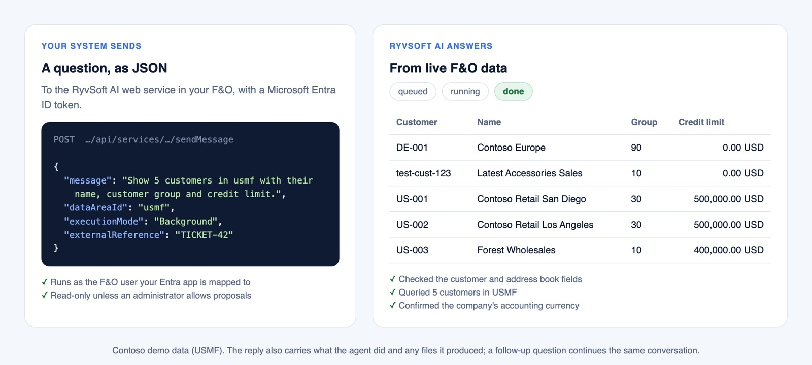

# RyvSoft AI — External API

Your own systems can work with RyvSoft AI the way your people do in the F&O side panel. Examples: a customer portal, a service desk, a chatbot, a workflow tool.

## What it is for

- **Answers for other systems.** A service-desk ticket asks "What is the credit limit and open balance of this customer?" and gets the answer from live F&O data.
- **Reports on request.** A portal asks for an export, and the Excel file the agent produces comes back to it.
- **Long jobs in the background.** A workflow tool hands over a bigger task, checks back later and collects the result.
- **Conversations, not one-off calls.** A follow-up question continues the same conversation, with its context.

## How it works

*An example call and its answer. Contoso demo data (USMF).*

- It is a standard F&O web service, secured by Microsoft Entra ID. Nothing runs outside your F&O.
- A call can wait for the answer, follow the agent step by step, or run as an F&O batch job.
- The caller gets the answer, a short list of what the agent did, and any files it created.

## Security

- **Off by default.** An administrator turns the API on in the AI Bot parameters.
- **The same permissions as the chat.** Every call runs as the F&O user your Entra application is mapped to: that user's roles, agents, tools and legal entities. The API adds no rights of its own.
- **No silent changes.** External calls are read-only by default. If an administrator allows it, the agent can only *propose* a change, and a person confirms it in F&O.
- Conversations started from outside are kept in F&O like any other chat, visible only to that user.

## Getting started

The full API reference comes with the evaluation and customer package. It covers setup, every call, error handling and code examples. To get it, [contact us](../README.md#contact).
